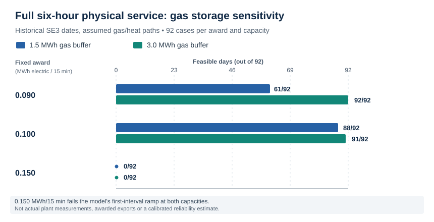

# BiogasFlex | Flexible biogas use, storage and energy-system resilience

**A reproducible research case study for doctoral application**  
**Author:** Abhijith Sivaprasadan, MSc Sustainable Energy Engineering, KTH Royal Institute of Technology  
**Research context:** Linköping University, Division of Energy Systems / Biogas Solutions Research Center (BSRC); vacancy [IEI-2026-00717](https://liu.se/en/work-at-liu/vacancies/30170)  
**Prepared:** November 2026 | **Software:** BiogasFlex v0.9.28 research-release candidate

> **Scope.** This is an independently developed applicant work sample, not a LiU/BSRC project, a peer-reviewed publication, a calibrated CHP digital twin or proof of real market revenues. Its completed work concerns **flexible use and buffering of assumed biogas supply**; production flexibility, regional resilience and policy instruments are proposed doctoral extensions.

## The research question

When fuel supply, heat obligations, electrical export commitments and operating constraints interact, **what flexibility can a biogas CHP system physically deliver, and under which assumptions does that flexibility cease to be feasible?**

This is relevant to BSRC's investigation of flexible, resilient and sustainable energy systems. A gas buffer may allow electricity generation to shift in time, but its value depends on CHP electrical and thermal limits, gas arrivals, market commitments and the definition of delivered service. The model is designed to test these conditions explicitly rather than to maximize a revenue figure irrespective of physical feasibility.

## Model and evidence

*Figure 1.* Reconstructed full six-hour service on **92 historical evaluation dates with synthetic gas/heat paths**. The feasibility count is **not** a field reliability probability, causal controller success rate or contracted delivery record.

The model represents a six-hour operating horizon at 15-minute resolution (24 intervals). Gas inventory and electrical output are constrained by

\[
S_{t+1}=S_t+(g_t-u_t)\Delta t,\qquad
E^{\rm export}_t=\eta_e u_t\Delta t ,
\]

where \(g_t\) is assumed gas input, \(u_t\) is CHP fuel consumption, \(S_t\) is gas energy stock (MWh lower heating value), and \(\Delta t=0.25\) h. Binary operation, initial-state and ramp limits, CHP rating, useful-heat service and backup/dump limits are included. For fixed awarded export, \(u_t\) is determined by the award and electrical efficiency; buffering alone cannot relax the generator ramp or manufacture absent gas. All monetary outputs are **assumption-dependent operating-contribution proxies**, not lifecycle project returns.

The external evidence is the [OPSD 2020-10-06 release](https://doi.org/10.25832/time_series/2020-10-06), specifically observed **2019 Swedish SE3 electricity prices and regional electrical-load forecast errors**. The original publisher dataset hash is verified before analysis. The study contains **8,756 valid hourly pairs**, with **271 complete source-training days** and **92 chronologically subsequent evaluation days**. Price errors are relative to a *constructed seven-day persistence baseline*, not archived bid-time forecasts. **Biogas production and site heat demand were not measured**: they are transparently declared, synthetic functions of paired regional source errors. The evaluation dates have been repeatedly inspected and must not be represented as a fresh untouched benchmark.

Methods include a two-stage MILP with common first-stage CHP commitments and idealized full-future-known continuous recourse, separate causal hourly replay, a minimum-gas reserve witness, hard fixed-export contract checks, bounded gas/heat sensitivity cases and independent physical/LP audit scripts. **Idealized recourse is not claimed to be a causal delivery controller.**

## What the completed study found

| Tested question | Result | Interpretation |
|---|---|---|
| Can a minimum-gas reserve protect a six-hour dispatch? | Modelled full-horizon feasibility rose **63/92 → 92/92**; protected terminal stock matched on **86/92** days per policy | A conditional model result under assumed future minimum gas—not verified plant resilience |
| Does greater buffering make fixed electricity awards physically possible? | At **0.090 MWh per 15 min**, **61/92 → 92/92** full-service days with **1.5 → 3.0 MWh** gas storage | Additional capacity addresses gas-buffer overflow in the synthetic cases |
| Can storage solve every contract failure? | At **0.150 MWh per 15 min**, **0/92** full-service days at either capacity | The declared first-interval electrical ramp is violated; storage cannot repair it |
| Are uncertainty and delivery guarantees interchangeable? | **14/54** preregistered bounded physical-feasibility certificates passed; only **one** under the full declared synthetic gas-support band | Bounds are hypothetical and cannot be presented as measured forecast coverage |
| Does accepting a contract establish its economic advantage? | **2,208** day-by-gate outcomes checked; **zero strict cyclic matched-service pairs**; **92 separately comparable equal-carryover pairs** had **zero mean operating-contribution difference** | No defensible claim of higher profit from these matched contracts |

The work deliberately preserves failures: some causal policies become infeasible, feasible electrical delivery can still violate terminal gas inventory, and no matched-service economic superiority emerges from the evaluated equal-carryover comparison. These are informative constraints, **not** inconvenient results to discard.

The verification record includes **23 checked parameters, 1,472 policy replays and 23,288 executed quarter-hour rows**. The corrected release candidate passed **nine GitHub Actions workflows** and platform qualification on Windows, Ubuntu and macOS, Python 3.11/3.13. The status is **research-software qualification**, not independent human methodological review or industrial qualification.

## Three research directions for the proposed PhD

The next questions are intentionally broader than the completed repository. Their design would need to be refined with LiU supervisors and BSRC practitioners.

| Doctoral extension | Testable question and potential method | Evidence needed / proposed outcome |
|---|---|---|
| **1. Flexible biogas production and utilization** | Can process-aware variation in feedstock handling, digester operation and gas upgrading shift useful energy across hours or days **without compromising biological stability and long-term methane yield**? Couple a validated dynamic production model to gas storage and multi-energy dispatch; compare production flexibility against gas-holder-only flexibility | Plant time series, substrate and process conditions, methane yields, restrictions and uncertainty; report feasible flexibility envelopes and lost-production trade-offs, not assumed instantaneous digester ramping |
| **2. Regional self-sufficiency and resilience** | Under disruptions to imported energy, feedstock transport or network availability, when do distributed biogas, heat, storage and alternative end uses improve **regional essential-service coverage**? Formulate spatially explicit, multi-period energy/material flows; evaluate matched demand and disruption scenarios | Regional waste/agricultural substrates, collection costs, biogas facilities, demand, gas/electric/heat networks and stakeholder-defined critical loads; report unserved energy, recovery time, resource use and distributional effects |
| **3. Market and policy uncertainty** | Which combinations of market tariffs, policy support, carbon accounting and investment choices change the preferred allocation of biogas among CHP, biomethane and heat? Use scenario/stochastic optimization with investment and lifecycle boundaries, comparing policy regimes against an explicitly fixed service unit | Actual equipment CAPEX/OPEX, relevant regulation/policy instruments, price scenarios, lifecycle inventories and stakeholder assumptions; report sensitivity, investment break-even and sustainability trade-offs—not bankable site forecasts |

**Research proposition.** Linking **biological production flexibility → short/long-duration gas storage → multi-sector demand → regional resilience → investment and policy** could reveal where biogas flexibility has system value, and where technological or institutional constraints prevent that value from being realized. The existing dispatch engine provides a reproducible starting point for the conversion/storage component; it does **not** establish the answers to those larger questions.

## Reproducibility, boundaries and evidence trail

- **Finite benchmark and methods:** [source-verified scenario methodology](V0921_SOURCE_VERIFIED_PAIRED_UNCERTAINTY_PROTOCOL.md), [original 92-day physical-envelope results](../reports/V0925_EXECUTED_92DAY_SOURCE_PAIRED_ENVELOPE.md), [fixed-contract acceptance protocol](V0927_CONTRACT_ACCEPTANCE_PROTOCOL.md).
- **Audit and code:** [model and field-qualification boundaries](V1_0_SCIENTIFIC_RELEASE_GATES.md), [integrated qualification protocol](V0928_RELEASE_QUALIFICATION.md), [executed all-platform A7 certificates](../data/evidence/v0928_green_a7_qualification_certificates.json), [successful A8-corrected candidate workflow](https://github.com/Open-Energy-Methods/biogasflex/actions/runs/44415532151).
- **Transparency:** [attribution and source rights](../DATA_ATTRIBUTION.md), [final methodological reviewer packet](V1_0_FINAL_REVIEW_PACKET.md), [external review still required](https://github.com/Open-Energy-Methods/biogasflex/issues/3).

**Not established:** true site-level gas/heat forecast-error covariance; validated anaerobic digester dynamics; calibrated CHP and gas-pressure/storage equipment; actual grid-meter contracts or settlement; empirical grid/islanded resilience; regional supply-chain optimization; policy impacts; complete capital economics; a new untouched independent holdout; or external human peer review.

The purpose of this work sample is to show a **traceable modelling method, falsifiable boundary conditions, reproducible computation and a credible path to richer transdisciplinary research**—not to suggest the doctoral research is already complete.
